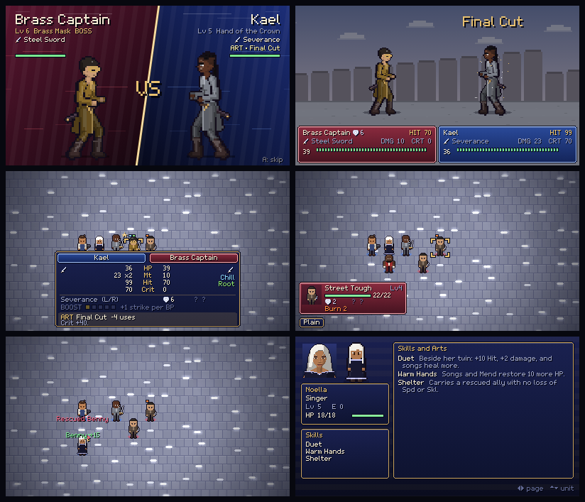

# All-Divine Tactics for Android

The web game, *The All-Divine: Tactics of the Open Hand*, packaged as a native Android app.
It runs fully offline and asks for no permissions.

| Path | What it is |
|---|---|
| [`web/index.html`](web/index.html) | The game: the artifact's second version merged with the fixes and battle scenes below. The artifact has been updated to the same build. |
| [`android/`](android/) | The Android app: a full-screen WebView around the game, plus [`android-shell.js`](android/app/src/main/assets/android-shell.js) for the touch layout, clipboard and haptics. |
| [`tools/render-icons.mjs`](tools/render-icons.mjs) | Redraws the launcher icon from the game's own pixel art (Abarax, Rose Divine). |
| [`tools/build-apk-offline.sh`](tools/build-apk-offline.sh) | Builds the APK on a machine without the Android SDK. |
| [`tools/playtest/`](tools/playtest/) | A bot that plays every chapter through the real input path, and the sweep that found the freeze. |
| [`tools/preview/duel-sheet.mjs`](tools/preview/duel-sheet.mjs) | Renders any duel frame by frame onto one sheet, for judging battle animation. |

## What is in this build

### New in 1.4

**Battle scenes happen where the fight is.** Thirty-eight painted backdrops replace the one plain
field. The scene is chosen from the tile the defender stands on and from the chapter's place: the
Jardins market with its awnings, the Mireille docks at night, rose gardens, orchards, salt flats,
the lighthouse spire, the Black Fort, taverns, foundries, throne rooms and the Garden itself.
Night chapters get night skies, snow falls where it snows, and leaves, petals, torches, neon,
steam and the sea move.

**Abarax and the whole cast are stronger.** Every friend starts with +2 HP and +1 to every other
stat, and grows 5% faster in every stat. Abarax grows a further 5–10% faster in each stat (Str,
Mag, Def, Res and HP the most), his two promotions give more, and he starts with a new skill,
*Rose Heart*: +2 damage and +10 Avo, rising with rank. His personal weapons gain 1 Mt every 5
levels, and everyone else's every 8. Saves from before get the same buff, as if they had grown
with it.

**Skills and arts have ranks.** Thirty-four skills scale: rank I for a first-tier class, II from
Lv 15 or on promotion, III from Lv 15 of the second tier and for the All-Divine. *Hot Blood III*
gives +40 Crit where *Hot Blood* gives +20, *Get Up III* works twice a battle, and so on. Arts
scale with weapon rank. At B they become *II* (Mt +2, Hit +5, Crit +5, wider splash and chain),
and at S they become *III* (twice that, plus a turn longer on any status). Enemies rank up with
their level too. The status screen, the forecast and the skill pages show the rank.

**Armour, outfits and accessories, worn where you can see them.** A new *Gear* option under
*Items* (on the world map and the prep screen) opens a wardrobe for each friend. It previews the
duel figure and the map figure wearing the piece, and the stat change before you commit. There
are three slots and twenty-six pieces:

- Seven pieces of armour: Leather Jerkin, Chain Hauberk, Steel Plate, Divine Plate, Rose-Iron
  Mail, Warded Mantle and Starwoven Mantle. They are drawn as breastplates, pauldrons, bracers,
  greaves and mantles.
- Seven outfits that change the clothes: Chef's Whites, Monk's Wraps, Duelist's Coat, Gala Gown,
  Traveler's Cloak, Night Market Suit and the Rose Divine Coat.
- Twelve accessories, each one visible: rings, a rose locket, circlets, a silk scarf, earrings,
  a charm, gloves and boots. Some do more than stats:
  - the Bell Charm keeps every status off;
  - the Coffee Flask starts every battle with an extra Boost point;
  - Gardener's Gloves heal 10% a turn;
  - Swift Boots give +1 Mov.

Scaling pieces grow with their wearer. The Rose Locket gives +1 HP every 3 levels, Rose-Iron Mail
+1 Def every 8, the Sun Circlet +1 Mag every 10, and the Rose Divine Coat +1 to every stat every
10 levels. A new game starts with a jerkin, a ring and a scarf, and older saves get the same
parcel. Shops across the continent stock the rest.

**Twenty-one new weapons, each with its own fight.** Each family below has its own choreography:

- Iron and Silver Greatswords: raised high in both hands and brought down hard enough to shake
  the ground.
- Rapier and Duelist's Rapier: a hop into the lunge and three thrusts too quick to count.
- Chakram and Moon Ring: thrown flat, through the target, and caught on the way home.
- War Hammer and Iron Maul: swung once round the body, then down like a falling roof.
- War Fan and Crane-Wing Fan: the fan opens on the turn, cuts with its edge, and the wind does the
  rest.
- Field and Reaper's Scythes: one wide reaping sweep.
- Chain Whip and Thorn Lash: cracked across the gap without closing in. They can drag the foe
  closer or root them.
- Longbow and Yew Warbow: drawn to the cheek and loosed high, so the arrow falls on them.
- Flintlock and Twin Pistols: from the hip to the eye in one motion, fanned three times on a
  crit.
- Three new gifts: Meteor, a burning stone from the sky; Verdance, vines and flowers that root;
  and Maelstrom, the sea turning round them, which chills.

Every family has its own art: *Cleave*, *Flurry*, *Ricochet*, *Shatter* (breaks a boss's shield
outright), *Tempest*, *Reap*, *Snare*, *Volley*, *Quick Draw*, *Cataclysm* and *Whirlpool*.

**Three new side quests:**

- *The Tailor of Rue Lumière* (after Chapter 9): hold the tailor's shop against Yaska's
  collectors for six turns. It pays in clothes, among them the Rose Divine Coat.
- *Iron and Embers* (after Chapter 15, with Vehday): break the Foundry Warden on the old
  foundry floor at Castemere.
- *The Reliquary of Moons* (after Chapter 19, with Oren and Gerace): four chests under the Hall
  of the Concord, and the Keeper of Moons, who drops the Divine Plate.


### New in 1.3

**Freezes.** The remaining freezes came from flows that could die quietly and leave the game
waiting. Each one now recovers:

- An error in a story, menu or shop flow left the world map, a town or the prep screen marked
  busy. Every one of those flows now clears the flag however it ends.
- An error in the enemy's turn stopped the battle with no one able to act. A watchdog now notices
  a battle that is waiting on nothing and moves it on.
- A scene that threw on every frame froze the screen. After a few failures in a row it is closed,
  and the game goes back to the map, the world, or the title.
- Every battle kept its fighters' drawings in memory, so a long session on a phone ran out. They
  are released now, and the heap stays flat across battles. The bloom pass's canvas also lives in
  memory now, so reading it each frame no longer stalls the GPU.
- If Android kills the page's renderer, the app rebuilds it instead of showing a blank screen.
- Options → *Report a problem* copies the error log (game version, device, what was on screen) to
  the clipboard, for anything still left.

**Arts.** Every weapon has a technique, readied in the forecast with **F** (Y on a controller, or
tap the ART row). An art costs extra uses and takes the place of Boost. Each weapon type has one:
blades *Windsweep* (no counter), fists *Haymaker* (knockback), poles *Skewer* (half Def), shot
*Deadeye*, flame *Wildfire*, bloom *Overgrowth*, tide *Riptide*, and Gold Flame *Sunburst*
(splash). Nineteen personal weapons have their own, from Kesra's *Three Breaths* to Vehday's
*True Level*. Bosses use arts too, from Normal up.

**Gifts and weapons do more than hurt.** Hits can Burn (a tenth of HP each turn, never lethal),
Root (cannot move), Chill (Spd −4) or Blind (Hit −25). Lightning, Spark and Gale-Widow chain to a
second foe. Gust, Cyclone and Tidebreak push, and the Harpoon pulls. Henri's poker burns, Sierra's
ivory blade chills, and Noella's night blade blinds. The forecast, the unit card and the status
screen all show what is in effect.

**Seventeen new skills**, learned at set levels: Second Helping, First Word (vantage), Hot Blood,
Rose Sol, Moon Bite, Bulwark, Thrift, Galeforce, Lone Wolf, Charm, Quick Riposte, Warm Hands,
Shelter, Kindle, Clear Mind, Trample and Slip. Every friend learns two to four. Saves past those
levels get the skills on the world map. A third page of the status screen lists every skill in
full.

**Rescue, Drop and Mend.** Any unit can lift a friend beside them out of harm and set them down
later; carrying halves Spd and Skl. Casters and singers can Mend the friend they carry, right after
the rescue or on a later turn.

**A face-off card before each battle scene**: the two fighters slam in from either side, with names,
levels, weapons and any art. It plays at double speed in the enemy's turn (bosses aside). A or B
skips it, and Options → *Battle intro* turns it off.



**Noella and Sierra always join.** They come in during Chapter 7 on turn 3, so a quicker win
skipped them. Winning the chapter now brings them, and saves that missed them get them back on
the world map.

### Earlier

**Two versions, merged.** The artifact's second version brought a bigger view (400×225, 24 px
tiles), paper-doll map figures with walk cycles, and diorama effects (bloom, tilt-shift, light
pools). This build keeps all of that and adds everything below. Battle fighters are drawn at
1.5×, the height the second version gave its battle sprites.

**The freeze after a command is fixed.** Four separate causes, all found by the playtest bot:

- Opening INFO from the attack forecast cleared the battle's busy flag while the attack was still
  running. When the target died, the map opened a phantom action menu over the kill animation and
  the enemy phase never started. Busy work is now counted, not flagged.
- Tapping an enemy to attack with a unit that had no usable weapon in reach (sealed gifts, or only
  ranged weapons) threw inside the forecast and left the map waiting forever.
- A screen fade that was already at its target never finished.
- Any error in a frame stopped the game loop for good; now it is logged and the next frame runs.

Also: *Items* returns to the action menu instead of ending the turn when nothing was used, and a
resumed suspend restores the lord check. A tap made during an animation or the enemy phase used to
wait and fire later, opening a stray map menu or ending the turn; now a tap counts only on the frame
it lands. A portrait phone no longer gets a squashed canvas.

**New art.** Portraits, map sprites and battle sprites are redrawn as adults with more structure.
Abarax's sides are shaved.

**Battle scenes for every kind of attack.** Fighters are now skeletons posed frame by frame, about
90 px tall:

- **Blades** are drawn from the scabbard, the fighter dashes in and cuts, dashes back, and sheathes.
  Criticals add a glint, a leap and a heavier cut.
- **Gifts** (magic): the caster raises both hands to call the gift, then sends it. All 21 gifts have
  their own effect, from Ember's fireball, Phoenix and Lightning to Tidebreak's wave, Rose Storm,
  Stoneshape and Gold Flame.
- **Everything else** has its own move too: knives (thrown at range), Vanity's crossed blades, the
  skillet's *clang*, fists (jab and straight, uppercut on a crit), the Open Hand's palm, lances and
  pokers (with mounted charges), the staff's twirl and leap, harpoons, axes, rifles, crossbows and
  the Plumb Bow.
- **Defenders** recoil, stagger on a crit, hop clear of a miss, and fall when they lose.
- **Controls:** hold fast-forward to speed a duel up, and press **B** to skip it.


## Install it on a phone

1. Get the `.apk`: from a [GitHub Release](https://github.com/Advoxsegoat/Pump.Widget/releases), or
   from the **Artifacts** box of the latest
   [*All-Divine Tactics APK* run](https://github.com/Advoxsegoat/Pump.Widget/actions/workflows/all-divine-tactics-apk.yml)
   (that one is a zip; open it first).
2. Open the file on the phone. Android asks to allow installs from your browser or file manager: allow it.
3. Play Protect may warn that the developer is unknown. That is expected for an app installed from
   outside the Play Store. Choose *Install anyway*.

Needs Android 7.0 or newer.

## Playing on Android

- **Touch:** the on-screen pad. Portrait puts the small buttons in their own row; landscape puts
  the D-pad and A/B either side of the screen like a handheld.
- **Back gesture or button:** the game's **B**. On the title screen it closes the app.
- **Controllers** (Bluetooth or USB): D-pad or stick to move, A confirm, B back, X info,
  Y danger zone, L1/R1 cycle units, Start menu, R2 fast-forward.
- **Saves** live on the phone, inside the app. Uninstalling the app deletes them, so use
  *Save → Show Save Code* before uninstalling (the code goes to the clipboard), and
  *Import Save Code* on the title screen to bring a game back.

## Update the game

Edit `web/index.html` and push; CI builds a new APK. Each build has a higher version code and the
same signing key, so it installs over the old one and keeps the saves.

`web/index.html` and the artifact are the same build, so a later artifact export can replace it.
Before shipping a change, run the playtest sweep (needs Playwright, `npm i -g playwright`):

```sh
node all-divine-tactics/tools/playtest/sweep.mjs all-divine-tactics/web/index.html 1 30000 4
```

It plays each chapter with fuzzed keyboard and touch input and reports any run that stops making
progress (`STUCK`) or throws (`ERROR`). `repro-info.mjs` replays the old freeze and should report
no phantom menu. The other scripts in `tools/playtest/` take the game's path too:

| Script | What it checks |
|---|---|
| `explore.mjs <game> [seeds] [frames] [parallel]` | Fuzzes everything outside a battle: world map, towns, shops, camp menus, saves. |
| `faults.mjs <game>` | Throws errors into the flows that used to freeze and checks that each one recovers. |
| `memprobe.mjs <game>` | Plays battle after battle and prints the heap and live canvases, to catch leaks. |
| `smoke.mjs <game> <outdir>` | Checks arts, statuses, skills, rescue and suspend, and saves screenshots of the new screens. |
| `smoke14.mjs <game> <outdir>` | Checks gear, ranks, the stat buffs and the new side quests, and renders sheets of every new weapon's duel, every backdrop and the wardrobe. |

## Build it yourself

- **CI:** [`.github/workflows/all-divine-tactics-apk.yml`](../.github/workflows/all-divine-tactics-apk.yml)
  builds on every push that touches `all-divine-tactics/`. To publish a GitHub Release, push a tag:
  `git tag all-divine-tactics-v1.0.0 && git push origin all-divine-tactics-v1.0.0`.
- **With the Android SDK** (Android Studio, JDK 17):
  `cd all-divine-tactics/android && ./gradlew assembleRelease`, output in `app/build/outputs/apk/release/`.
- **Without the SDK** (e.g. a sandbox that cannot reach `dl.google.com`):
  `all-divine-tactics/tools/build-apk-offline.sh` builds the same app from Maven Central tools only.

## Signing, and the road to the Play Store

Builds are signed with [`android/app/sideload.keystore`](android/app/sideload.keystore). It is
committed on purpose, so that every build can update the last one, but anyone can read it. That
is fine for sideloading and wrong for a store listing.

For Google Play:

1. Settle the package name first. It is `com.advoxsegoat.alldivinetactics` (`applicationId` in
   [`android/app/build.gradle`](android/app/build.gradle)), and it can never change after the first upload.
2. Make a private upload key and keep it somewhere safe, outside the repo:
   `keytool -genkeypair -keystore upload.keystore -alias upload -keyalg RSA -keysize 2048 -validity 10000`
3. Add four repository secrets (*Settings → Secrets and variables → Actions*):
   `ANDROID_KEYSTORE_BASE64` (output of `base64 -w0 upload.keystore`), `ANDROID_KEYSTORE_PASSWORD`,
   `ANDROID_KEY_ALIAS` (`upload`), `ANDROID_KEY_PASSWORD`.
4. CI then signs with that key and also builds the `.aab` bundle that Play asks for.

A phone that has the sideload build has to uninstall it before installing a build signed with
the new key (Android rejects updates signed with a different key). Export a save code first.
