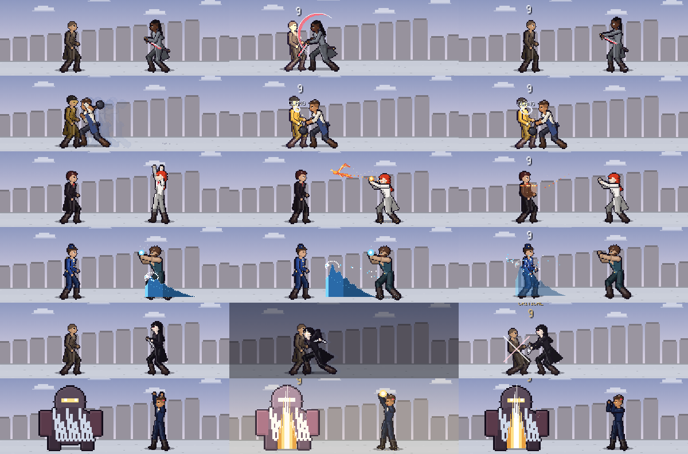

# All-Divine Tactics for Android

The web game, *The All-Divine: Tactics of the Open Hand*, packaged as a native Android app.
It runs fully offline and asks for no permissions.

| Path | What it is |
|---|---|
| [`web/index.html`](web/index.html) | The game: the artifact's second version merged with the fixes and battle scenes below. The artifact has been updated to the same build. |
| [`android/`](android/) | The Android app: a full-screen WebView around the game, plus [`android-shell.js`](android/app/src/main/assets/android-shell.js) for the touch layout, clipboard and haptics. |
| [`tools/render-icons.mjs`](tools/render-icons.mjs) | Redraws the launcher icon from the game's own pixel art (Abarax, Rose Divine). |
| [`tools/build-apk-offline.sh`](tools/build-apk-offline.sh) | Builds the APK on a machine without the Android SDK. |
| [`tools/playtest/`](tools/playtest/) | A bot that plays every chapter through the real input path, and the sweep that found the freeze. |
| [`tools/preview/duel-sheet.mjs`](tools/preview/duel-sheet.mjs) | Renders any duel frame by frame onto one sheet, for judging battle animation. |

## What is in this build

**Two versions, merged.** The artifact's second version brought a bigger view (400×225, 24 px
tiles), paper-doll map figures with walk cycles, and diorama effects (bloom, tilt-shift, light
pools). This build keeps all of that and adds everything below. Battle fighters are drawn at
1.5×, the height the second version gave its battle sprites.

**The freeze after a command is fixed.** Four separate causes, all found by the playtest bot:

- Opening INFO from the attack forecast cleared the battle's busy flag while the attack was still
  running. When the target died, the map opened a phantom action menu over the kill animation and
  the enemy phase never started. Busy work is now counted, not flagged.
- Tapping an enemy to attack with a unit that had no usable weapon in reach (sealed gifts, or only
  ranged weapons) threw inside the forecast and left the map waiting forever.
- A screen fade that was already at its target never finished.
- Any error in a frame stopped the game loop for good; now it is logged and the next frame runs.

Also: *Items* returns to the action menu instead of ending the turn when nothing was used, and a
resumed suspend restores the lord check. A tap made during an animation or the enemy phase used to
wait and fire later, opening a stray map menu or ending the turn; now a tap counts only on the frame
it lands. A portrait phone no longer gets a squashed canvas.

**New art.** Portraits, map sprites and battle sprites are redrawn as adults with more structure.
Abarax's sides are shaved.

**Battle scenes for every kind of attack.** Fighters are now skeletons posed frame by frame, about
90 px tall:

- **Blades** are drawn from the scabbard, the fighter dashes in and cuts, dashes back, and sheathes.
  Criticals add a glint, a leap and a heavier cut.
- **Gifts** (magic): the caster raises both hands to call the gift, then sends it. All 21 gifts have
  their own effect, from Ember's fireball, Phoenix and Lightning to Tidebreak's wave, Rose Storm,
  Stoneshape and Gold Flame.
- **Everything else** has its own move too: knives (thrown at range), Vanity's crossed blades, the
  skillet's *clang*, fists (jab and straight, uppercut on a crit), the Open Hand's palm, lances and
  pokers (with mounted charges), the staff's twirl and leap, harpoons, axes, rifles, crossbows and
  the Plumb Bow.
- **Defenders** recoil, stagger on a crit, hop clear of a miss, and fall when they lose.
- **Controls:** hold fast-forward to speed a duel up, and press **B** to skip it.



## Install it on a phone

1. Get the `.apk`: from a [GitHub Release](https://github.com/Advoxsegoat/Pump.Widget/releases), or
   from the **Artifacts** box of the latest
   [*All-Divine Tactics APK* run](https://github.com/Advoxsegoat/Pump.Widget/actions/workflows/all-divine-tactics-apk.yml)
   (that one is a zip; open it first).
2. Open the file on the phone. Android asks to allow installs from your browser or file manager: allow it.
3. Play Protect may warn that the developer is unknown. That is expected for an app installed from
   outside the Play Store. Choose *Install anyway*.

Needs Android 7.0 or newer.

## Playing on Android

- **Touch:** the on-screen pad. Portrait puts the small buttons in their own row; landscape puts
  the D-pad and A/B either side of the screen like a handheld.
- **Back gesture or button:** the game's **B**. On the title screen it closes the app.
- **Controllers** (Bluetooth or USB): D-pad or stick to move, A confirm, B back, X info,
  Y danger zone, L1/R1 cycle units, Start menu, R2 fast-forward.
- **Saves** live on the phone, inside the app. Uninstalling the app deletes them, so use
  *Save → Show Save Code* before uninstalling (the code goes to the clipboard), and
  *Import Save Code* on the title screen to bring a game back.

## Update the game

Edit `web/index.html` and push; CI builds a new APK. Each build has a higher version code and the
same signing key, so it installs over the old one and keeps the saves.

`web/index.html` and the artifact are the same build, so a later artifact export can replace it.
Before shipping a change, run the playtest sweep (needs Playwright, `npm i -g playwright`):

```sh
node all-divine-tactics/tools/playtest/sweep.mjs all-divine-tactics/web/index.html 1 30000 4
```

It plays each chapter with fuzzed keyboard and touch input and reports any run that stops making
progress (`STUCK`) or throws (`ERROR`). `repro-info.mjs` replays the old freeze and should report
no phantom menu.

## Build it yourself

- **CI:** [`.github/workflows/all-divine-tactics-apk.yml`](../.github/workflows/all-divine-tactics-apk.yml)
  builds on every push that touches `all-divine-tactics/`. To publish a GitHub Release, push a tag:
  `git tag all-divine-tactics-v1.0.0 && git push origin all-divine-tactics-v1.0.0`.
- **With the Android SDK** (Android Studio, JDK 17):
  `cd all-divine-tactics/android && ./gradlew assembleRelease`, output in `app/build/outputs/apk/release/`.
- **Without the SDK** (e.g. a sandbox that cannot reach `dl.google.com`):
  `all-divine-tactics/tools/build-apk-offline.sh` builds the same app from Maven Central tools only.

## Signing, and the road to the Play Store

Builds are signed with [`android/app/sideload.keystore`](android/app/sideload.keystore). It is
committed on purpose, so that every build can update the last one, but anyone can read it. That
is fine for sideloading and wrong for a store listing.

For Google Play:

1. Settle the package name first. It is `com.advoxsegoat.alldivinetactics` (`applicationId` in
   [`android/app/build.gradle`](android/app/build.gradle)), and it can never change after the first upload.
2. Make a private upload key and keep it somewhere safe, outside the repo:
   `keytool -genkeypair -keystore upload.keystore -alias upload -keyalg RSA -keysize 2048 -validity 10000`
3. Add four repository secrets (*Settings → Secrets and variables → Actions*):
   `ANDROID_KEYSTORE_BASE64` (output of `base64 -w0 upload.keystore`), `ANDROID_KEYSTORE_PASSWORD`,
   `ANDROID_KEY_ALIAS` (`upload`), `ANDROID_KEY_PASSWORD`.
4. CI then signs with that key and also builds the `.aab` bundle that Play asks for.

A phone that has the sideload build has to uninstall it before installing a build signed with
the new key (Android rejects updates signed with a different key). Export a save code first.
